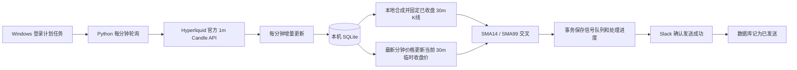

# XYZ100 30 分钟 SMA14/99 信号程序

保留 14/99 策略，改用用户确认的 **Hyperliquid `xyz:XYZ100`**。这是独立的新目录，旧的 NQ 采集、策略和回测文件不变。

**Mac 版本见 [macOS 运行说明](README-macOS.md)**。两个系统使用同一个 `bot.py` 和同一套信号、数据库去重逻辑；启动和后台托管方式不同。

**远程查看见 [私人 Sites 看板说明](README-Sites.md)**。采集与 Slack 继续在 Windows 运行，可选将只读快照同步到私人站点；不上传 Slack token。

## 数据源选择

| 来源 | 本次核实结果 | 本版选择 |
| --- | --- | --- |
| IB NQ 期货 | 可以获取，但单个合约有到期日。若继续用 NQ，还需要定义自动换月和价格衔接口径 | 不在本版混用 |
| 新浪 QQQ | 实际读到了常规报价和盘后字段；未证明该接口覆盖连续夜盘历史 | 不作为本版数据源 |
| Hyperliquid `xyz:XYZ100` | 官方 Candle API 可直接读取 1m、30m 数据，已实测周六行情；永续产品不要求程序逐季更换 NQ 合约 | 使用此源 |

XYZ100 不是 NQ 或 QQQ，价格、交易时段、流动性和产品规则不同。这里保留的是 SMA14/99 的规则，**此前 NQ 回测盈利不能直接套用到 XYZ100**。

截至 2026-10-31，Nasdaq 官方说明现有美股交易时段为美东 04:00–20:00，并计划于 2026-12-06 扩展至 23/5，仍以市场准备及适用监管变更为条件。这不意味着新浪接口已提供完整夜盘数据；经纪商另行提供的夜盘也需要对应的数据源。[Nasdaq 官方说明](https://www.nasdaq.com/articles/data/nasdaqs-global-and-us-trading-sessions)

## 系统设计



- 一个 Python 进程，每分钟轮询；仅依赖 `requests`，不需要 TWS、钱包、Hyperliquid 私钥、pandas 或 btalib。
- **只请求 1m 数据，不请求交易所的 30m K 线。** 按上海时间，周六 05:00 至周一 06:00 暂停行情请求、信号计算和 Sites 上传；SMA 窗口只计真实开市 30m K 线，周末不补造 K 线，也不算数据缺口。开市后自动恢复。缺少完整预热缓存时回看约 3,300 个开市分钟；缓存已有连续 98 根已收盘 30m K 线时，即使还未建立策略基线也复用缓存。之后从已保存的最新开市分钟开始补取，正常每轮约 2–3 根，覆盖上一分钟的最终值。停机恢复时请求缺失区间。
- SQLite 保存分钟 OHLCV；本地按每小时 `:00–:30`、`:30–下一小时 :00` 合成 30m K 线。结束后额外等 10 秒，确认包含完整的 30 根分钟记录，再固定保存；以后不会改写已固定的 30m K 线。缺分钟时停止处理，不插值补造价格；交易所明确返回的零成交分钟可以参与合成。
- **当前未收盘的 30m K 线每分钟更新，并可直接触发信号。** 采用当前分钟 K 线的 `close`（截至请求时的最新成交价快照，并非等待这一分钟结束）。SMA14 = 最近 13 根已收盘 30m 收盘价 + 当前价，除以 14；SMA99 用最近 98 根 + 当前价，除以 99。不是把每个分钟价格直接当成一根 30m K 线。
- 例如 09:12：09:00 之前的 30m K 线固定，09:00–09:30 的临时收盘价用 09:12 的最新快照。09:13 再更新一次；09:30 之后固定上一根、开始下一根。程序每 60 秒采样，不是逐笔推送，可能漏掉两次采样之间短暂发生又消失的交叉。
- SMA14 上穿 SMA99 发 BUY，下穿发 SELL；只有方向改变时才发，相等时延续上一次关系。
- 同一根 30m K 线内可以 BUY → SELL → BUY，分别记录独立信号 ID；持续在同一方向不重复发。消息标注“盘中暂定，未收盘，可能反向”、检测时刻和 K 线区间。最终收盘仍保持同方向时不再重复确认。
- 第一次启动连同当前盘中关系一起建立基线，不发历史信号；以后重启保留盘中方向和待发队列。已生成但未成功发送的消息会重试；停机期间仅按补回的 **30m 最终收盘价** 补算交叉，不能完整重现停机期间的盘中来回变化。更换 Slack 频道时，该频道独立建立基线。
- 延迟超过 60 秒的消息标注“补发信号”；收盘补算与盘中信号分开标注。
- 生成信号和推进处理进度在同一数据库事务中完成。Slack 明确失败不记成功；收到确认后才标记已发送，429 遵循 Retry-After。
- 数据过期、电脑时间明显错误、30m 历史缺口或数据格式不正确时，停止生成/发送信号并写日志；不补造价格、不自动切换其他数据源。
- 分钟请求失败或当前分钟快照过期时停止本轮处理和投递，自动退避后再试；成功后恢复每分钟轮询。
- 连续 3 次行情请求或站点同步失败后，Slack 发一条数据更新告警；HTTP 401/403/429 立即告警。恢复后再发一条恢复消息。告警投递失败时会限频重试；电脑关机或休眠期间无法实时发送。
- 程序只发送通知，没有下单、持仓或账户资金操作。

## Windows 首次运行

建议 Windows 10/11、Python 3.11 或更新版本。复制**整个文件夹**到这台 Windows 的本机目录，例如：

```text
%USERPROFILE%\Trading\xyz100_signal_bot
```

不要只复制 `bot.py`。如果尚未安装 Python，使用 [Python 官方 Windows 安装程序](https://www.python.org/downloads/windows/)。以下命令在 PowerShell 中运行。

### 1. 安装依赖并检查行情

```powershell
cd "$env:USERPROFILE\Trading\xyz100_signal_bot"
py -3 -m pip install -r requirements.txt
.\check.cmd
```

`check.cmd` 只读取公共分钟行情并在内存合成 30m，显示已收盘时间、正在形成的 K 线区间、最新价、盘中 SMA14/99 和关系；不需要 Slack token，不写正式数据库、不发消息。`relation` 为 1 表示 14>99，-1 表示 14<99。每次独立执行 `--check` 都会重新加载预热历史，常驻进程使用增量更新。

若电脑没有 `py` 启动器但已有 `python`，安装依赖时改用 `python -m pip install -r requirements.txt`；启动脚本也会自动回退到 `python`。

### 2. 配置现有 Slack bot

先运行一次：

```powershell
.\run.cmd
```

第一次会创建私有配置并退出，提示编辑：

```powershell
notepad "$env:LOCALAPPDATA\XYZ100SignalBot\config.json"
```

填入原来可用的 Slack bot token 和目标频道，例如：

```json
{
  "slack_bot_token": "xoxb-替换为原来有效的BotToken",
  "slack_channel": "#fut-trading-30mins"
}
```

这个文件在本机用户数据目录，不在代码文件夹/OneDrive 中。token 不写进代码、日志或行情数据库。使用现有 bot 即可；需要 `chat:write` 权限且 bot 能访问目标频道。[Slack 官方接口说明](https://docs.slack.dev/reference/methods/chat.postMessage/)

### 3. 主动发送一条配置测试

```powershell
.\run.cmd --test-slack
```

这个命令会发送一条明确写有“配置测试／不是交易信号”的真实消息。它不建立或推进策略基线。确认频道收到后，再启动正常运行：

```powershell
.\run.cmd
```

首次出现 `Baseline initialized` 属于正常现象；即使当前 14<99，也不会立即重发历史卖出消息。之后等待新的交叉；本机没有信号时不定时刷 Slack。

### 4. 安装登录后常驻任务

先在手动运行的窗口按 Ctrl+C 停止程序，然后运行：

```powershell
.\install_task.cmd
```

安装器会创建/更新并立即启动本程序自己的 `XYZ100-MA14-99` 计划任务，使用当前用户、低权限运行，不保存 Windows 密码、不修改 PowerShell 执行策略。以后登录 Windows 后启动；进程异常退出后间隔 1 分钟尝试重启，最多 3 次。普通网络错误由程序自身持续轮询恢复，不消耗进程重启次数。计划任务不允许重复启动自己的实例，也不会被默认 72 小时运行上限停止。

**这是登录后自启，不是登录前的 Windows 服务。** 注销、关机、睡眠或重启后尚未登录时不会持续采集。保持电脑接通电源、网络正常，并在 Windows 电源设置中按需关闭自动睡眠。若要无人登录的开机运行，需要另做服务部署，当前版本没有代你改系统账户或自动登录设置。

任务配置依据 [Microsoft schtasks 文档](https://learn.microsoft.com/en-us/windows-server/administration/windows-commands/schtasks-create) 和 [无限运行时间设置](https://learn.microsoft.com/en-us/windows/win32/taskschd/tasksettings-executiontimelimit)。本机已完成任务关键字段单测和 [Microsoft 官方 XSD](https://learn.microsoft.com/en-us/windows/win32/taskschd/task-scheduler-schema) 校验；尚未在目标 Windows 实机注册验证。

## 看日志、停机和重启

配置、状态数据库及日志统一放在：

```text
%LOCALAPPDATA%\XYZ100SignalBot\
    config.json
    signals.sqlite3
    bot.log
```

日志限制为每份 5 MB，最多保留 3 份轮转备份；数据库不自动删除历史行情。正常每分钟出现一次 `Healthy`，包含正在形成的 K 线起点、最新价和 SMA 值。整点/半点的前 10 秒会等待上一根收盘数据稳定，下一轮继续。

```powershell
Get-Content "$env:LOCALAPPDATA\XYZ100SignalBot\bot.log" -Tail 20
schtasks /Query /TN XYZ100-MA14-99 /V /FO LIST
```

临时停止/重新启动计划任务：

```powershell
schtasks /End /TN XYZ100-MA14-99
schtasks /Run /TN XYZ100-MA14-99
```

需要停用登录触发时用 `schtasks /Change /TN XYZ100-MA14-99 /DISABLE`；恢复时将 `/DISABLE` 改为 `/ENABLE`。停止和重启不删除 SQLite，已有通知记录继续有效。复制代码到其他目录不会迁移或清空本机状态；仅在一台电脑上正式运行，不能依赖 OneDrive 协调多机发送。

## 在 localhost 查看图表

保留原来的采集/Slack 程序运行，在另一个 PowerShell 窗口打开网页服务：

```powershell
cd "$env:USERPROFILE\Trading\xyz100_signal_bot"
.\run.cmd --dashboard
```

程序会打开 **http://localhost:8765**。Mac 使用 `./run_macos.command --dashboard`，详见 [Mac 说明](README-macOS.md)。这是运行电脑自己的 localhost，不能用另一台电脑的 localhost 访问。

- 30m 或 5m K 线/收盘线，叠加 SMA14/99；30m 可选 6 小时至 30 天，5m 可选 6/24/72 小时。5m 由已保存的 1m 行情聚合，只用于查看，Slack 仍使用 30m 策略。
- 最后一根未收盘 K 线用已保存的分钟行情更新并标注阴影；过去的均线按各根最终收盘价计算，不能还原当时所有盘中波动。
- 30m 图中标记数据库实际记录的 BUY/SELL；表格显示检测时刻、价格、盘中/收盘补算及 Slack 已发送/待发送状态。5m 图不伪装成实际 Slack 信号。
- 页面每 5 秒读取一次本机数据库，**不会请求交易所、启动采集或发送 Slack**。可下载包含 SQLite 完整备份、所有数据表 CSV 与派生 5m K 线 CSV 的 ZIP。
- 如果还未启动采集，另开一个窗口运行不带 `--dashboard` 的 `run.cmd`；首次会建立基线，历史 K 线不会凭空变成已发信号。没有数据库时显示操作提示，不生成模拟行情。
- 最新分钟过期时页面提示检查采集及网络；周六 05:00 至周一 06:00（上海时间）显示计划休市暂停。历史不足 14/99 根或开市时段有缺口时不跨缺口绘制相应均线；可展开 K 线数值表核对。
- 仅监听 `127.0.0.1:8765`，网页只读 SQLite；导出 ZIP 不含私有配置或 token，也不开放远程访问；不增加依赖。端口已被占用时先使用已运行的看板，或停止原看板后重开。

关闭浏览器不会停止采集或网页服务。在网页服务的窗口按 Ctrl+C 只停止网页；采集程序和已有系统自启任务按前文分别停止。

## 网络与历史边界

- 正常常驻采集每 60 秒调用一次行情接口。请求超时、HTTP 错误、无效行情等连续失败时，约等待 **60、120、240、480、600 秒**，另加最多 5 秒随机延迟；不会在单次请求里立即循环重试。HTTP `Retry-After` 支持秒数或日期，服务器要求更长时照等；成功一轮后恢复每 60 秒。
- 周末计划暂停期间不会发行情请求或 Sites 快照；预定休市不会触发行情故障告警。周一 06:00（上海时间）后继续请求，开市时段发生的网络或限流错误仍按下列策略告警和重试。
- 每个请求有连接 5 秒、读取 20 秒的超时设置。失败会保留已存行情和信号队列，暂停本轮信号处理；恢复后补取缺失分钟。不要为了恢复网络删除数据库。
- 只有行情/数据错误会增加行情退避；Slack 发送错误保留待发通知，不会让正常的行情采集逐步退避。Slack 的 429 等待时间仍保存在各条通知上。
- 看板每 5 秒只读 SQLite，不占交易所请求额度。保持一个正式采集实例；反复执行 `--check` 每次都会重新请求预热数据，不适合当监控轮询。
- Hyperliquid 官方目前按公网 IP 合计每分钟 1,200 权重，`candleSnapshot` 基础权重 20，并按每 60 根返回数据增加权重；这不是 1,200 次调用。共用公网出口的其他 Hyperliquid 程序或代理用户也会占额度，不能保证永不限流。[官方限流说明](https://hyperliquid.gitbook.io/hyperliquid-docs/for-developers/api/rate-limits-and-user-limits)
- 日志中出现 `HTTP 429` 表示接口返回限流；超时、TLS 连接错误、5xx 或历史缺口是不同问题。日志记录 `next attempt in ...s`，看板对过期行情给出提示。无需靠重启维持重试；行情退避计时只保存在当前进程内，反复重启会重置它。
- Windows 必须能访问 `https://api.hyperliquid.xyz/info` 和 `https://slack.com/api/chat.postMessage`。保留 HTTPS 证书验证，不使用关闭证书检查来解决连接问题。
- 使用 Requests 默认代理机制。需要代理时先在目标 Windows 正确配置并运行 `check.cmd` 验证；临时 PowerShell 环境变量不会自动传给独立计划任务。若使用用户环境变量配置代理，重新登录后再启动计划任务。[Requests 官方说明](https://docs.python-requests.org/en/latest/user/advanced/#proxies)
- 官方 Candle API 只保留每种周期最近 5,000 根。本版只使用 1m，约可补回 3.47 天；不保证补回更长停机期间的分钟数据。已保存到本机的数据继续保留。
- 若分钟历史有不可恢复的缺口，程序保留原记录并停止信号处理，需先补齐缺失数据或决定重新建立基线，不会跨缺口猜测交叉，也不会自动请求原生 30m 代替。
- SQLite 解决正常重启和同机并发去重；**Slack 已接收但回包丢失，或在接收后、数据库提交前崩溃，仍可能重复**。Slack 与本机 SQLite 不能作为同一个事务提交。消息中的信号 ID 可用于识别这种极端重复。

API 字段、周期及历史上限见 [Hyperliquid 官方 Candle snapshot 文档](https://hyperliquid.gitbook.io/hyperliquid-docs/for-developers/api/info-endpoint#candle-snapshot)；产品背景见 [trade[XYZ] 官方说明](https://docs.trade.xyz/)。

## 验证状态

```powershell
py -3 -m unittest -v test_bot.py test_macos.py test_dashboard.py test_site_sync.py
```

当前 50 项离线测试通过，覆盖盘中 BUY/SELL/BUY、多信号 ID、SMA 窗口、本地 OHLCV 合成、已收盘数据固定、增量请求、收盘衔接、旧库迁移、重启去重、漏发重试、429、断档和过期保护，以及两种系统的安装配置。请求控制测试验证 Retry-After、退避上限、实际调度冷却、恢复重置、预热缓存复用和 Slack 失败不拖慢行情。网页测试验证只读、均线、历史缺口和 HTTP 隔离；Sites 同步测试验证独立退避、后台线程、写入确认和凭据隔离。测试只使用模拟 Slack，没有对真实接口进行限流压测。

`source_check.json` 和 `macos_source_check.json` 是本次盘中模式的真实公共行情检查，包含检查时刻和正在形成的 K 线；只是当时的快照，不是持续监控状态。

`live_validation.json` 记录临时数据库的真实采集、本地合成和重启增量请求验证；另用原生 30m 行情独立核对已合成 OHLC 和成交笔数。这个额外请求只用于验证，不在程序运行路径中。真实 Slack 消息数为 0，正式用户数据目录没有被检查修改。`macos_validation.json` 和 `task_schema_validation.json` 保留早期平台安装验证的时间与状态，不代表当前后台服务已启用。

## 从之前的收盘模式升级

先停止旧进程，再替换代码后重启；Mac 已安装自启时需重新运行 `./install_macos.command`，让本机运行副本更新。无需删除数据库。程序自动迁移已发送/待发送记录和策略方向，旧队列表保留为 `outbox_closed_v1` 备份；以前已保存的 30m 历史也继续使用。更新后的两个 ZIP 包包含相同的策略代码。

代码已能读取并保存公共行情；**目标 Windows 的网络、计划任务和真实 Slack 投递仍需按以上步骤验证**。不要为了重启而删除 `signals.sqlite3`，否则会丢失原处理进度，并在下一次启动重新建立基线。
